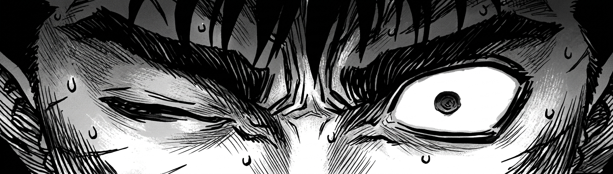

<div align="center">
  
</div>

<<div align="center">

# Brillian Wicaksono

**Full Stack Developer · Robotics Enthusiast**

<sub>Membangun asisten AI, antarmuka modern, dan sistem embedded.</sub>

</div>

<p align="center">
  
  
  
</p>

---

## 🎯 Tentang Saya

<table>
<tr>
<td width="58%" valign="middle">

```js
const brillian = {
  role: "Full Stack Developer & Robotics",
  location: "Indonesia",

  building: [
    "Pillow Island (AI Desktop)",
    "Robot Periferal (ESP32)"
  ],

  learning: ["Python + Tauri", "Rust", "UI/UX"],

  tech: {
    frontend: ["HTML", "CSS", "JS", "Tauri"],
    backend:  ["Python", "Rust"],
    hardware: ["ESP32", "Arduino"]
  }
};
```

</td>
<td width="42%" align="center" valign="middle">
  
</td>
</tr>
</table>

<blockquote>
  <i>"Make it work, make it right, make it fast."</i><br>
  <sub>— Kent Beck</sub>
</blockquote>

---

## 🔭 Proyek Saat Ini

| Proyek | Deskripsi | Teknologi |
|:--|:--|:--|
| 🏝️ **Pillow Island** | Asisten AI Desktop dengan antarmuka modern | `Python` `JavaScript` `Tauri` |
| 🤖 **Robot Periferal** | Robot periferal pintar berbasis mikrokontroler | `ESP32` `Arduino` `C++` |

---

## 📬 Connect With Me

<p align="left">
  <a href="https://github.com/Brillian132"></a>
  <a href="[https://www.linkedin.com/in/USERNAME](https://www.linkedin.com/in/brillian-wicaksono-98b90b2a3/)"></a>
  <a href="https://instagram.com/brillian.wicaksono17"></a>
  <a href="https://x.com/USERNAME"></a>
  <a href="https://discord.gg/INVITE"></a>
  <a href="mailto:brillian.wicaksono23@gmail.com"></a>
</p>

---

## 🛠️ Tech Stack

<p align="left">
  
</p>
<p align="left">
  
</p>

<p align="left">
  
  
  
  
  
  
</p>

---

## 📊 GitHub Analytics

<p align="center">
  
  
</p>

<p align="center">
  
</p>

<p align="center">
  
</p>

---

## 🏆 GitHub Trophies

<p align="center">
  
</p>

---


<p align="center">
  <i>⭐ Terima kasih sudah berkunjung! Jangan ragu untuk berkolaborasi.</i>
</p>
